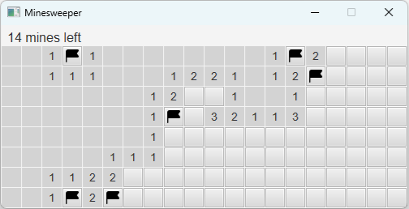

# Minesweeper

[](https://github.com/prmr/Minesweeper/actions/workflows/maven.yml)

A JavaFX version of the classic [Minesweeper](https://en.wikipedia.org/wiki/Minesweeper_(video_game)) video game. A demonstration application for the book [Introduction to Software Design with Java](https://link.springer.com/book/10.1007/978-3-030-24094-3).



## How to Play

The application shows a _minefield_ in the form of a grid. A number of mines are randomly positioned. Click on any cell to reveal it, and possibly blow up if a mine is positioned there. Right-click on a cell to mark the position of a mine. When revealed, a cell indicates the number of mines present in the eight neighboring cells (or blank if there are none). The game is won when all unmined cells are revealed.

## Building and Running with Maven

The following commands can be run from the command line or by right-clicking on the `pom.xml` file and selecting `Run As...`.

* Compiling: `mvn clean compile`
* Validating style: `mvn compile checkstyle:check`
* Testing: `mvn clean test`
* Packaging: `mvn clean package` or `mvn clean package -Pfat` to create a fat jar. This command will also create the javadocs in `target/docs`
* Running: `mvn clean javafx:run@run`

By default,packaging creates a thin jar as `target/Minesweeper-VERSION.jar`. To run the packaged application from the thin jar, you must have the JavaFX library downloaded somewhere, assumed to be `PATH_TO_JAVAFX_LIB`. To run the jar, open a command-line terminal window and enter the command below from the same directory where you downloaded the file, or write a script to execute it more conveniently.

```
java --module-path PATH_TO_JAVAFX_LIB --add-modules=javafx.controls -jar Minesweeper-VERSION.jar
```

To run the packaged application from the far jar, simply run the jar as:

```
java -jar Minesweeper-VERSION.jar
```

## Building and Running with Eclipse

If you used Maven to fetch the dependencies, you can simply run the application and test directly from Eclipse.

* Right-click on the project and select `Run As -> Java Application`. Select `Minesweeper` from the list. 
* To run the tests, select `Run As - > JUnit Test`.

_**MacOs Users**: When you run the application, from the run configuration, make sure the checkbox "Use the -XstartOnFirstThread argument when launching with SWT" is _not_ checked._ 

## Art Credit

<a href="https://www.flaticon.com/free-icons/mine" title="mine icons">Mine icons created by Creaticca Creative Agency - Flaticon</a>